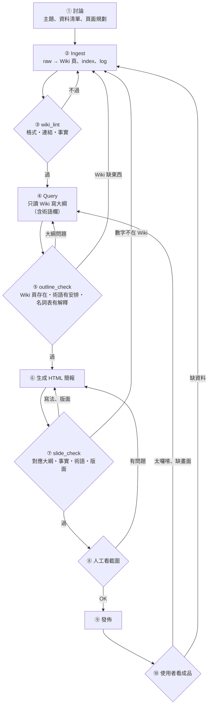

# Loop / Graph 設計

## 最終版流程圖（v2）



文字版：

```
討論 → Ingest → [wiki_lint] → Query（大綱）→ [outline_check] → 生成簡報 → [slide_check] → [人工看截圖] → 發佈 → [使用者看成品]
          ↑  不過 ←┘              ↑  大綱問題 ←┘                ↑  版面／寫法 ←┘        ↑ 有問題 ←┘                │
          ├──────── Wiki 缺東西 ───┴────────── 數字不在 Wiki ────┘                                                  │
          └──────────────────────────────── 缺資料（補 ingest）／太囉嗦（回大綱）────────────────────────────────────┘
```

這張圖是跑了三輪才長成的：v1 沒有 ⑤ outline_check；⑤ 是第一輪跑完、發現術語問題才加的。⑩ 是發佈後使用者說「廢話多、要實機畫面」才加的，那一輪也讓大綱多了「只講一件事」欄、slide_check 多了字數上限。原因見 [反思.md](反思.md)。

## 每個節點做什麼、產出什麼

| 節點 | 誰做 | 輸入 | 產出 | 紀錄 |
|---|---|---|---|---|
| ① 討論 | 我＋AI | 作業說明、Stormcast 專案 | 主題、12 份資料清單、頁面規劃、檢查規則 | `紀錄/01-討論紀錄.md` |
| ② Ingest | AI | `raw/` 的原始資料（唯讀） | `wiki/` 15 頁（含 index、log、SCHEMA） | `wiki/log.md` |
| ③ wiki_lint | 程式 | `wiki/`、`raw/` | 問題清單 | `紀錄/02～05` |
| ④ Query | AI | **只讀 `wiki/`** | 簡報大綱：每張教什麼、用哪幾頁 Wiki、哪些術語在這張第一次出現 | `紀錄/06`、`紀錄/08` |
| ⑤ outline_check | 程式 | 大綱、名詞表、`tools/terms.json` | 問題清單 | `紀錄/09` |
| ⑥ 生成 | AI | 大綱、Wiki | `slides/index.html` | — |
| ⑦ slide_check | 程式（含無頭瀏覽器） | 簡報、Wiki、大綱 | 問題清單＋18 張截圖 | `紀錄/07、10～12` |
| ⑧ 人工檢查 | AI 看截圖 | 截圖 | 工具抓不到的版面問題 | 寫在 `紀錄/08`、`12`、`17` |
| ⑩ 使用者回饋 | 我 | 發佈的簡報 | 「該不該講」這種工具判斷不了的問題 | `紀錄/13` |

## 三個檢查工具查什麼

**③ wiki_lint**（`tools/wiki_lint.mjs`）
- 格式：每頁有 `title`、`type`、`sources`，sources 列的 raw 檔都存在
- 連結：`[[頁名]]` 都連得到；每頁都在 index；沒有孤兒頁
- 事實：頁面裡的提交編號、反引號標的名字、兩位數以上的數字，都要在**這頁自己列的來源**裡找得到（前後不能接別的數字，「37」不能靠「3702」過關）

**⑤ outline_check**（`tools/outline_check.mjs`）
- 大綱每張的 Wiki 頁都存在
- `tools/terms.json` 的 16 個術語，要嘛安排在某一張「第一次出現」（只安排一次），要嘛寫進「不用的術語」
- 安排到的術語在名詞表裡有解釋；有安排術語的那張，Wiki 頁要包含「名詞表」

**⑦ slide_check**（`tools/slide_check.mjs`）
- 對應：每張的 Wiki 頁存在，而且**跟大綱一模一樣**（簡報不能自己換來源）
- 事實：投影片上的數字、提交編號、`<code>` 內容，都要在它列的 Wiki 頁裡找得到
- 術語：第一次出現的那張要有解釋（`<dfn>` 或後面接「（說明）」）
- 不用的術語：大綱說不用的，簡報裡出現就算錯
- 字數：一張最多 150 字（名詞小抄、來源列不算）
- 版面：用無頭 Edge 以 1280×720 畫每一張，內容不能超出、不能壓到來源列；只用到上方 65% 以下就警告

事實檢查是一條鏈：**簡報的數字 → 必須在 Wiki 頁 → Wiki 頁的數字必須在 raw**。所以簡報上任何一個數字都追得回原始資料。

## 哪些步驟會重複執行？

| 迴圈 | 什麼時候轉 | 這次實際轉了幾圈 |
|---|---|---|
| ②⇄③ 寫 Wiki ⇄ wiki_lint | 每收一份資料、每改一次 Wiki 就跑 | 3 次正式執行＋1 次自我測試（故意放錯），之後每改一次都重跑 |
| ④⇄⑤ 大綱 ⇄ outline_check | 大綱改了就跑 | v2 兩次（第 1 次 2 個問題）、v3 兩次 |
| ⑥⇄⑦ 生成 ⇄ slide_check | 簡報改了就跑 | v1、v2 共 4 次（13 → 10 → 0 → 0 個問題）；v3 共 3 次（1 → 0 → 0） |
| ⑤⑦→② 回補 Wiki | 檢查發現 Wiki 缺東西 | 2 次（名詞表補 7 個術語、補 docLint） |
| ⑧→⑥ 人工 → 重新生成 | 看截圖發現問題 | 3 次（頁碼重疊與下半部空白；列表空白被刪；檢視頁截圖的工具列變雜訊、字太小） |
| ⑩→②④ 使用者 → 補資料、重寫大綱 | 使用者看完發佈的簡報 | 1 次：補 2 份資料、新增 Wiki 頁「檢視頁」，大綱 v3，18 張 → 15 張 |

## 哪些地方需要檢查或重新生成？

- **Wiki 頁**：事實對不上來源 → 改 Wiki 頁或補來源，不是改檢查。
- **大綱**：術語沒安排 → 重寫大綱那一列；名詞表沒有 → **回 ② 補 Wiki**，不准在簡報上自己編解釋。
- **簡報**：版面、術語寫法 → 重新生成那幾張；數字在 Wiki 找不到 → 回 ② 查來源。
- **檢查工具本身**：誤報時改工具，但要記下是「工具錯」還是「內容錯」，不能為了讓它過就放寬。每次改完工具先跑 `node --check` 確認語法，再用故意放錯的頁面測一次。

## 為什麼這樣設計

1. **Query 只讀 Wiki、不讀 raw**：這是 LLM Wiki 的重點。知識整理一次、存在 Wiki，之後每次查詢都用同一份；簡報缺什麼就回去補 Wiki，Wiki 會越用越完整，而不是每次從原始資料重新撈。
2. **事實檢查做成一條鏈**：生成式 AI 最大的風險是編出看起來合理的數字。每一層都只准用上一層有的東西，任何數字都追得回原始資料。
3. **檢查做成程式、不靠 AI 自己看**：AI 檢查自己寫的東西有盲點（Wiki 裡的審查流程案例就是這樣）。程式檢查每次結果都一樣，可以重跑。
4. **還是留人工看截圖、留使用者回饋**：版面好不好看要人看；「這個細節值不值得講」更是只有讀者能判斷。使用者一句「誰修的、怎麼修的沒人在意」，讓整份簡報重寫。
5. **把檢查放在離錯誤最近的地方**：術語問題出在大綱沒決定，就在大綱檢查；不要等簡報生成完才發現、整份重做。這跟 Stormcast 開發時「每出一次錯就把檢查往前移」是同一個想法（見 `wiki/開發迴圈.md`）。
